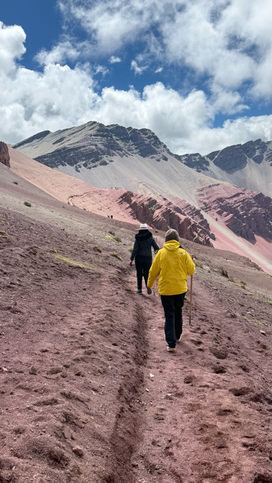
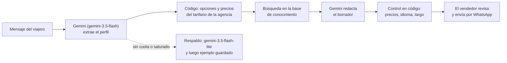
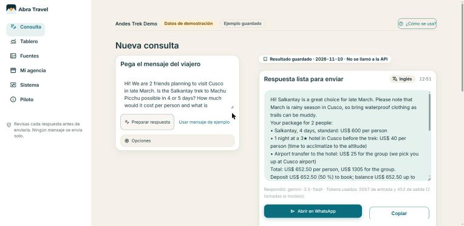
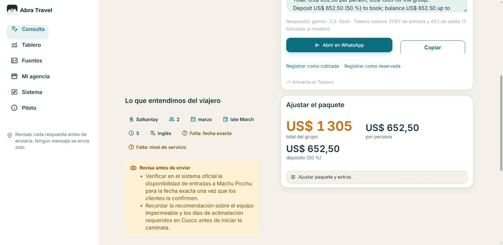
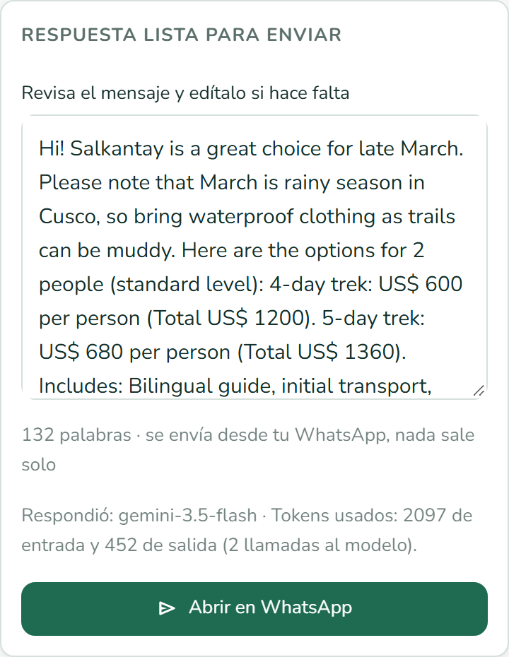

# Abra Travel

## 1. One-liner

> Abra Travel prepara en segundos la respuesta a cada consulta de viajeros para las agencias de turismo, empezando por Cusco, con sus propios precios y en el idioma de cada viajero.

**El nombre:** el abra es el punto más alto de un trek (como el abra Salkantay) y viene de "abrir": abre cada conversación con el viajero.

Proyecto final de la Diplomatura de Ciencia de Datos para las Ciencias Sociales y la Gestión Pública (Q-Lab PUCP, 2026).

## 2. Founder

<table>
<tr>
<td width="270" valign="top">

<br>
<em>Gabriela Pozo (casaca amarilla), en la montaña de 7 colores, Cusco.</em>
</td>
<td valign="top">

**Gabriela Pozo.** En el centro de Cusco converso seguido con turistas que van a hacer trekking, como el Salkantay, y mis amigos me piden que les recomiende una agencia, pero no siempre tengo la respuesta. Escribí a 6 agencias de trekking, grandes y pequeñas: todas respondieron recién al día siguiente, la mitad sin precio en el chat y dos en otro idioma. Por eso creé un asistente que prepara en segundos una respuesta clara, con los precios de cada agencia y en el idioma del turista, para que cualquier agencia responda rápido y bien a cualquier hora.

</td>
</tr>
</table>

## 3. Problema

Escribimos a 6 agencias de trekking de Cusco (2 grandes, 2 medianas y 2 pequeñas) con el mismo mensaje en inglés, enviado por WhatsApp entre las 11:55 p. m. del 9 de noviembre y las 12:07 a. m. del 10. Ninguna persona respondió esa noche (solo una agencia envió un mensaje automático, en español): la primera respuesta humana llegó a las 8:23 a. m., entre 8 y 10 horas y media después. Solo 3 de 6 dieron el precio en el chat; las demás lo mandaron en un PDF de 11 o 12 páginas o en enlaces. 2 de 6 respondieron en español a un mensaje en inglés. Solo 1 hizo una pregunta al viajero (pidió su correo). Los precios del Salkantay que nos dieron fueron de US$ 499 a 755 por persona (mediana US$ 695). Es una prueba pequeña e ilustrativa, no una muestra representativa. Datos: [`docs/research/cliente_misterioso.csv`](docs/research/cliente_misterioso.csv).

- A los viajeros les cuesta entender qué incluye y qué no cada cotización (lo dicen las 2 respuestas de la encuesta); por eso el borrador siempre lo explica.
- De día, la agencia más rápida responde en menos de 1 hora; a medianoche, en la prueba de cliente misterioso, las agencias tardaron de 8 a 10 horas: el problema se concentra fuera de horario.
- Evidencia y sus límites (2 conversaciones informales, una encuesta con 2 respuestas y un cliente misterioso con 6 agencias): [`docs/research/`](docs/research/).

## 4. Solución e insight

**Insight:** el problema no es de día sino fuera de horario. De noche nadie atiende, y por la mañana la respuesta llega sin precio en el chat o en otro idioma. Un borrador listo, con los precios de la propia agencia y en el idioma del viajero, permite responder en minutos todo lo que llegó de noche.

Hoy el vendedor revisa y envía cada respuesta: por la mañana responde en minutos todas las consultas que llegaron de noche, antes que la competencia. El **modo nocturno** muestra, para las consultas que llegan fuera de horario, la primera respuesta segura que se enviaría sola (armada por código: precio desde el tarifario, qué incluye y lo que falta preguntar), y solo cuando el control no encontró problemas.

Cómo funciona:

1. La agencia pega el mensaje del viajero, en cualquier idioma.
2. El modelo extrae su perfil (personas, mes, días, trek, nivel, presupuesto) como salida estructurada.
3. El código elige opciones del **tarifario de la agencia** y calcula precios, total y depósito. El modelo nunca calcula precios.
4. Se buscan en la base de conocimiento (`data/knowledge/`, con fuentes y fechas) los fragmentos del trek y de las condiciones de reserva.
5. El modelo redacta un borrador corto en el idioma del viajero, y un control revisa en código que no haya precios inventados, que esté en el idioma correcto y que tenga menos de 150 palabras.
6. **Armar paquete**, como cotizan las agencias de Cusco: precio base del trek + extras opcionales con su unidad (bolsa de dormir, bastones, Huayna Picchu, caballo, habitación individual, servicio privado) + días en Cusco antes del trek (hotel 3★ o 4★ y traslado) + recargo si paga con tarjeta o PayPal. El modelo sugiere hasta 3 extras según lo que escribió el viajero; el vendedor marca o desmarca y el código recalcula el desglose y el borrador. Precios y fuentes: `docs/fuentes_precios.md`.
7. El vendedor revisa, edita y lo abre en WhatsApp con un clic. Puede registrar la consulta como cotizada o reservada (solo su perfil, sin el mensaje ni el teléfono).



Las reglas de la respuesta salen de la prueba de cliente misterioso (`docs/research/cliente_misterioso.md`).

## 5. Why now

- Los modelos de lenguaje ya entienden mensajes en cualquier idioma y devuelven **salidas estructuradas** que el código puede validar; el demo funciona con el nivel gratuito de Gemini.
- Las 6 agencias de la prueba atienden por WhatsApp: el canal ya existe y basta un enlace para abrir la respuesta lista.
- Cada agencia ya tiene su tarifario; solo falta convertirlo en respuestas rápidas sin que el modelo invente precios.

## 6. Demo

**App:** [https://abra-travel.streamlit.app](https://abra-travel.streamlit.app)

Video de respaldo: [pendiente]

Modelo: **Gemini** (`gemini-3.5-flash`), con respaldo `gemini-3.5-flash-lite` si se queda sin cuota o está saturado, y un **ejemplo guardado** de una consulta real si los dos fallan. El botón "Usar mensaje de ejemplo" muestra ese resultado sin llamar a la API.

Qué se ve en la app:

- **Nueva consulta:** el borrador listo para WhatsApp, con un **cronómetro** ("Respuesta lista en X s"), el perfil del viajero, las opciones del tarifario, los avisos del control y **Armar paquete** (trek + extras + días en Cusco + recargo por forma de pago).
- **Modo nocturno:** si la consulta llega fuera de horario, muestra la respuesta segura que se enviaría sola. En la app es una **simulación**; el webhook de WhatsApp con Twilio (`server/webhook.py`) está escrito y probado, pero aún no conectado en vivo.
- **Mi agencia:** tarifario editable, extras, recargos, horario de atención y meta semanal.
- **Tablero:** arriba, **Mi semana** (solo las consultas registradas por el vendedor: meta semanal, monto reservado frente a la semana anterior, racha y cotizaciones que esperan seguimiento). Debajo, consultas, tasa de cierre, sin respuesta y monto reservado por mes del viaje, trek y país, con **datos sintéticos** del demo (`data/consultas_sinteticas.csv`).







## 7. Modelo de negocio

- **Costo por consulta (medido):** cada consulta hace 2 llamadas al modelo (extraer el perfil y redactar el borrador) y usa unos 2 100 tokens de entrada y 450 de salida en total (en el ejemplo guardado: 2 097 y 452).
- **El demo usa el nivel gratuito de Gemini** (20 solicitudes por día y por modelo; cada consulta usa 2). No incluimos el precio del nivel de pago porque no lo verificamos en la página oficial.
- **Para la agencia:** primero un piloto gratis de 2 semanas con 3 agencias, midiendo cuántas ventas se recuperan respondiendo antes. El precio de la suscripción se definirá con esos datos.

## 8. Herramientas del curso

| Sesión | Qué usamos | Dónde está |
| --- | --- | --- |
| **08: salidas estructuradas + RAG** | El modelo devuelve el perfil del viajero como un esquema pydantic; la respuesta se apoya en fragmentos recuperados de una base de conocimiento con fuentes y fechas | `ai/schemas.py`, `ai/llm.py`, `ai/prompts.py`, `ai/pipeline.py`, `ai/knowledge.py`, `data/knowledge/`, `data/knowledge_huaraz/` |
| **05: Tablero** | Métricas, gráficos y filtros de las consultas, y la sección Mi semana | `core/tablero.py`, `core/mi_semana.py`, `app/app.py` (página Tablero), `data/consultas_sinteticas.csv`, `scripts/generar_consultas_sinteticas.py` |

## 9. Qué hizo el agente

**Claude Code (el agente)** escribió el código de la app, del flujo con el modelo, del Tablero, de los paquetes y del webhook de WhatsApp; las pruebas automáticas (`tests/`, sin llamadas a la API); la base de conocimiento de Cusco y Huaraz a partir de fuentes públicas citadas en cada archivo; el análisis de precios de mercado y las capturas.

**Yo decidí** el problema, el cliente (agencias de trekking), el nicho (Cusco, empezando por el Salkantay), los precios del tarifario demo y sus fuentes, e hice la prueba de cliente misterioso con 6 agencias, las conversaciones y la encuesta.

## Qué sigue

1. **Piloto gratis de 2 semanas con 3 agencias**, midiendo las ventas recuperadas.
2. **Modo nocturno con WhatsApp real:** el webhook ya funciona con el sandbox de Twilio. La integración directa con Meta se intentó, pero la cuenta quedó bloqueada temporalmente por iniciar sesión desde un dispositivo nuevo.
3. **Paquetes** (trek + extras + días en Cusco) para subir el ticket de cada venta.
4. **Mapa de la ruta en la respuesta al viajero:** lo pidió la [conversación 2](docs/research/conversacion_2.md); los trazados de 3 rutas ya están en `data/rutas/`.
5. **Luego Huaraz, Arequipa y Puno**; después los departamentos con boleto turístico (Ley 32586) y Latinoamérica. Un destino nuevo es solo una carpeta nueva de conocimiento más el tarifario de la agencia: `data/knowledge_huaraz/` (Santa Cruz y Laguna 69) ya tiene el mismo formato que la de Cusco, sin cambiar el código.

### Riesgos

- **El modelo puede equivocarse.** Por eso los precios los calcula el código, un control revisa el borrador y el vendedor siempre lo revisa antes de enviarlo.
- **Las reglas cambian** (permisos, entradas a Machu Picchu, horarios). Cada archivo de conocimiento tiene fecha y fuentes, y hay que revisarlo cada temporada.
- **Límites de la capa gratuita de Gemini**: 20 solicitudes por día y por modelo. Cada consulta usa 2. Por eso hay un modelo de respaldo y un ejemplo guardado.
- **Marca:** Abra ya se usa en otros rubros de software (criptomonedas, gestión empresarial); antes de lanzar habría que registrar la marca en Indecopi.

## Datos y privacidad

- Al registrar una consulta se guarda solo su perfil (trek, idioma, mes del viaje, personas, nivel, estado y monto), nunca el mensaje ni el teléfono del viajero. Ese archivo no se sube al repositorio.
- El Tablero del demo usa **datos sintéticos**, marcados como tales: no son de ninguna agencia real.
- El log del webhook guarda solo el identificador del mensaje, el idioma, el trek y el estado; nunca textos ni teléfonos.
- Las claves van en `.env` (excluido por `.gitignore`) o en los secretos de Streamlit Cloud; nunca en el código.

## Cómo correrlo

```bash
pip install -r requirements.txt
cp .env.example .env      # pon tu GEMINI_API_KEY (https://aistudio.google.com/apikey)
streamlit run app/app.py  # y abre http://localhost:8501
```

- Modelos de Gemini: `GEMINI_MODEL=gemini-3.5-flash` (principal) y `GEMINI_MODEL_RESPALDO=gemini-3.5-flash-lite` (respaldo).
- **Cadena de respaldo:** si el modelo principal se queda sin cuota diaria (429) o sigue saturado (503), la misma consulta se repite con el de respaldo; si los dos fallan, la app muestra un ejemplo guardado de una consulta real (`data/ejemplo_guardado.json`) con un aviso claro. La app muestra qué modelo respondió.
- El botón "Usar mensaje de ejemplo" muestra ese resultado guardado sin llamar a la API. Para volver a generarlo: `python scripts/guardar_ejemplo.py` (2 llamadas).
- Pruebas (no llaman a la API): `python -m unittest discover tests`
- Probar con el modelo real desde la terminal: `python scripts/probar_consultas.py`

### Modo nocturno con WhatsApp (sandbox de Twilio)

`server/webhook.py` (FastAPI) responde solo las consultas que llegan **fuera de horario** (8:00–20:00, hora de Lima):

1. El viajero escribe al número del sandbox; Twilio hace `POST /whatsapp`.
2. Se valida la firma `X-Twilio-Signature` con el auth token y se contesta al instante con un TwiML vacío.
3. En segundo plano, el modelo extrae el perfil y el código arma la respuesta segura de `core/respuesta_nocturna.py` (precio "desde" del tarifario, qué incluye, lo que falta preguntar y la hora del asesor). Si queda en espera del vendedor, se envía solo un acuse de recibo sin montos.
4. Se envía con la API de Twilio. Un mismo `MessageSid` no se responde dos veces; el log no guarda textos ni teléfonos.

Despliegue: `render.yaml` (Render, plan gratuito) con `requirements-server.txt`; salud en `GET /salud`. Para probar de día: `FORZAR_MODO_NOCTURNO=1`. En local: `uvicorn server.webhook:app --port 8000`.

**Límites:** el sandbox es para pruebas, no para clientes reales. Usa un **número compartido de Twilio** (+1 415 523 8886), y **cada persona debe unirse antes** enviando `join <código>` desde su WhatsApp; la unión vence a los 3 días. Envía como máximo un mensaje cada 3 segundos y solo puede responder dentro de las 24 horas desde el último mensaje del viajero. En el plan gratuito de Render el servicio se duerme tras 15 minutos sin tráfico y tarda cerca de un minuto en despertar, y la lista de mensajes ya respondidos se pierde al reiniciarse. Para un número propio de la agencia hace falta la API de WhatsApp Business aprobada por Meta.

### Estructura

| Carpeta | Qué contiene |
| --- | --- |
| `app/` | App web en Streamlit: "Nueva consulta", "Mi agencia" y "Tablero". Diseño en `docs/diseno.md` |
| `ai/` | Esquemas (pydantic), conexión con el modelo, instrucciones, búsqueda y flujo principal |
| `server/` | Webhook de WhatsApp (FastAPI + Twilio) para el modo nocturno |
| `core/` | Cotización con el tarifario, paquetes, enlace de WhatsApp, respuesta del modo nocturno, Tablero y Mi semana |
| `data/` | Tarifario demo, precios de mercado, base de conocimiento de Cusco y de Huaraz |
| `docs/` | Capturas, foto, fuentes de precios e investigación (evidencia pública, cliente misterioso, verificación oficial) |
| `evaluacion/` | 20 consultas sintéticas para evaluar las respuestas |
| `scripts/` | Análisis de precios (genera el tarifario), consultas sintéticas del Tablero y prueba con el modelo real |
| `tests/` | Pruebas automáticas |

## Licencia

[MIT](LICENSE).
